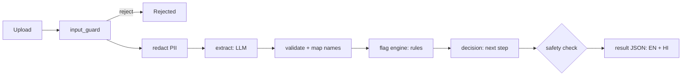

# LabLens: Lab Report Explainer

> Numbers below come from the JSON files in `evals/` and from `models/*.card.json`, not from
> memory.

**Live demo:** https://lablens.64-20-56-251.sslip.io (synthetic reports only; real uploads are
switched off on this deployment).

## What it is, and what it is not

LabLens reads an Indian-style lab report (PDF or image) and explains it in plain English and
Hindi: which values are outside range, how serious, and what a sensible next step is.

- **It is not a diagnosis and not medical advice.** It never names a condition and never
  recommends treatment. Reference ranges, critical thresholds and LOINC codes are demo values,
  not clinician-reviewed.
- **Code decides, the LLM explains.** Flags, severity, critical values and the next step come from
  deterministic rules. The LLM only reads the report (extraction) and phrases the explanation.
  Every explanation passes a rule-based safety check before it is shown; critical values always
  get fixed, template urgent text.

## Architecture

An ADK 2.0 `Workflow` wires the nodes. Full file-by-file map: [docs/codebase-map.md](docs/codebase-map.md)
(it was last verified before the API and frontend landed, so treat its "not built" notes as
out of date). Spec: [PLAN.md](PLAN.md); API contract: [openapi.yaml](openapi.yaml).



Backend: FastAPI in `src/lablens/api/`. Frontend: React + Vite in `frontend/`, served from
`frontend/dist` when it exists.

## Setup

Requires Python 3.11 or newer and Node.js.

```sh
python3.11 -m venv .venv && source .venv/bin/activate
pip install -r requirements.txt

cp .env.example .env     # then fill in GOOGLE_API_KEY (use a paid-tier Gemini key)
```

`.env.example` lists `GOOGLE_API_KEY` and `GOOGLE_GENAI_USE_VERTEXAI`. Optional tuning variables
(model, budget caps, rate limits, cache directory) are read in `src/lablens/config.py`; the
paid-tier switch for real uploads is `LABLENS_PAID_TIER_KEY` and the Google sign-in audience is
`LABLENS_GOOGLE_CLIENT_ID`. Never commit `.env`.

Frontend:

```sh
cd frontend
npm install
npm run build            # type-checks, then builds to frontend/dist
npm run dev:mock         # UI against mock data, no backend or key needed
```

Run the API (the package lives in `src/` and is not pip-installed, hence `--app-dir`):

```sh
uvicorn --app-dir src lablens.api.app:app
```

See the whole ADK workflow graph and step through a run in `adk web` (uses the live Gemini key
in `.env`):

```sh
adk web adk_apps
```

Open the address it prints, choose `lablens_workflow`, and send
`{"path": "data/reports/source/D02.pdf"}`. The graph button next to the app name shows every node,
including the two ML nodes, `normalize_names` and `pattern_model`.

## Tests and evals

```sh
python -m pytest -q                                  # offline, no key needed
python scripts/train_ml.py [--out DIR]               # train ML nodes -> models/
python evals/ml_eval.py                              # ML eval, no LLM -> evals/results_ml.json
python evals/critical_eval.py [--live] [--max-inr 5] # critical-value set -> evals/results_critical.json
python evals/extract_eval.py [--no-cache] [--max-inr 20]   # LIVE Gemini, spends money; 15 source PDFs
python evals/explain_dev.py [--max-inr 10] [--no-cache] [--pace 25]   # LIVE Gemini, spends money
```

`critical_eval.py` is offline unless `--live` is passed. The extract and explain evals call Gemini
and need the key. All spend is recorded in the budget ledger (`cache/budget.sqlite`).

## Data

All data is synthetic. Details: [data/README.md](data/README.md),
[data/critical_set/README.md](data/critical_set/README.md).

| Set | Size | Use |
|---|---|---|
| Source reports `D01-D15` | 15 PDFs | Development and tuning only |
| Eval cases `E01-E30` | 30, derived from the sources, frozen before tuning | Scored; the only cases in headline numbers |
| Critical-value set | 312 rows (196 critical, 116 not), plus 10 PDFs `C01-C10` | Held out: never used to tune thresholds, prompts or models |

Real lab reports were used only as format references for layouts and were not copied into the
repository or any evaluation. No real patient data is stored here. Regenerate with
`pip install -r requirements-data.txt` and `scripts/generate_reports.py` /
`scripts/generate_critical_set.py`.

## Results

Intervals are 95% Wilson intervals from the results files.

### The 30 frozen eval cases, end to end (1 run, live Gemini)

From `evals/results_eval30.json` / `.md`, produced by `python evals/run.py --runs 1`.

| What | Result |
|---|---|
| Extraction recall / precision | 252 / 252 rows each (interval 0.985 to 1.0) |
| Value, unit, name accuracy | 252 / 252 each |
| Range accuracy | 251 / 252 (99.6%) |
| Flags all correct, per report | 30 / 30 (interval 0.886 to 1.0) |
| Next step and urgency | 30 / 30 |
| Critical recall | 2 / 2 (interval 0.34 to 1.0, uninformative; see the held-out set below) |
| Explanation statements grounded in cited tests | 192 / 192 |
| English / Hindi consistency | 30 / 30 |
| Unsafe advice | 0 / 30 (interval 0 to 0.113) |
| Fallback to template text | 0 / 30 |
| Latency per report | p50 10.0 s, p95 23.7 s |
| Spend for the run | about INR 13.82 |

This is one run, not three, so run-to-run variation is not measured. An earlier run on
2026-11-21 (`evals/results_eval30_2026-11-21.json`) had the same flags and next steps, but 70% of
its reports fell back to template text because Gemini returned 503 (overloaded) errors on a
free-tier key; this run used a different key and saw no 503s. The explanation checks are rule-based; no LLM judge
or human rating of explanation quality has been run.

### Other evaluations

| What | Result | Source |
|---|---|---|
| Extraction on the 15 clean source PDFs | 114 / 114 rows matched; value, unit and range accuracy all 100%; 0 rows dropped | `evals/results_extract_dev.json` |
| Critical values caught, held-out set | 196 / 196 (interval 0.98 to 1.0) | `evals/results_critical.json` |
| False criticals on non-critical rows | 0 / 116 (interval 0 to 0.032) | `evals/results_critical.json` |
| Live pipeline run on the 10 critical PDFs | 10 / 10 all checks ok (interval 0.72 to 1.0); spent about INR 3.59 | `evals/results_critical.json` |

Read these carefully:

- **The 114 / 114 extraction is a ceiling, not a field result.** The 15 source PDFs are clean,
  digital and were used for tuning. Scans, photos and real layouts will do worse.
- **Critical recall is measured on the separate set** because the 30 eval cases contain only 2
  critical rows (2 / 2, interval 0.34 to 1.0, uninformative). The 196 criticals are
  rule-decided. With 196 / 196 the true recall is still only bounded below by about 98%.
- **The flag model must not decide criticals.** On held-out rows it misses 18 of 62 critical
  values (44 / 62 caught), and its overall flag accuracy there is 1379 / 2400 (interval 0.55 to
  0.59). So critical values are decided by rules only. The flag model is trained and
  evaluated but is not loaded by the application.
- **The name matcher does not earn its place.** On held-out names it abstains on 342 / 395 and is
  right on 87 / 395 (22%), against 68 / 395 for a dictionary built from the training names
  (the fair baseline). It mapped 7 of 395 names to the wrong test; the dictionary mapped 0. It is
  kept only as a fallback after the dictionary, and every model-made mapping is marked
  "please verify".
- **The pattern model** (grouping abnormal results) gets 575 / 645 exact on held-out sets but
  27 / 30 on the eval cases, where a simple package rule gets 29 / 30. It is optional.
- **All labels come from the project's own generators and rule engine, so the ML numbers are
  optimistic.** The held-out name set was inspected once after the first run and the name model's
  features changed, so it is slightly less blind than intended.

### Spend

Total LLM spend recorded in the local budget ledger (`cache/budget.sqlite`) so far: about
INR 45.60, against a planned cap of INR 500.

## Privacy and safety

- **Redaction before the LLM.** Names and identifiers are masked (`src/lablens/redact.py`) before
  anything is sent to Gemini; the extraction node only receives the redacted document.
  Redaction is pattern-based and not perfect (see Limitations).
- **Real uploads are cache-only and paid-tier only.** Real uploads are never written to the
  response cache, and are accepted only with a paid-tier key on the server.
- **History is opt-in.** Saved history and trends need Google sign-in and an explicit tick;
  otherwise nothing is saved.
- **Budget guard.** Each LLM call reserves budget first and is refused past the guard
  (`LABLENS_BUDGET_GUARD_INR`). The public demo has a global daily cap of INR 50
  (`LABLENS_DAILY_CAP_INR`) and a per-IP rate limit; past the cap only cached sample reports
  are served.
- **Safety check.** Banned phrases and direction words are enforced by `src/lablens/safety.py`;
  on any failure the explanations are dropped and the flags and next step still return.

## Limitations

- Reference ranges, critical limits and Hindi text are not clinician-reviewed. The Hindi text was
  model-written and then reviewed by hand by the author; automatic checks cover only numbers,
  units, citations and direction words.
- Only the synthetic reports have been evaluated; real-world scans and layouts are untested.
- Redaction is pattern-based; a bare name that appears after the first test row may not be masked
  unless a label or honorific is present.

## Licence and attribution

Code is MIT licensed: see [LICENSE](LICENSE). The NidaanKosha dataset (Eka Care, CC-BY-SA-4.0) was
considered in the plan but **was not used**: `scripts/derive_reference_stats.py` exists, but
`reference/nidaankosha_stats.json` was never generated and no NidaanKosha rows or statistics are
in this repository. How AI tools were used: [AI_USAGE.md](AI_USAGE.md).
