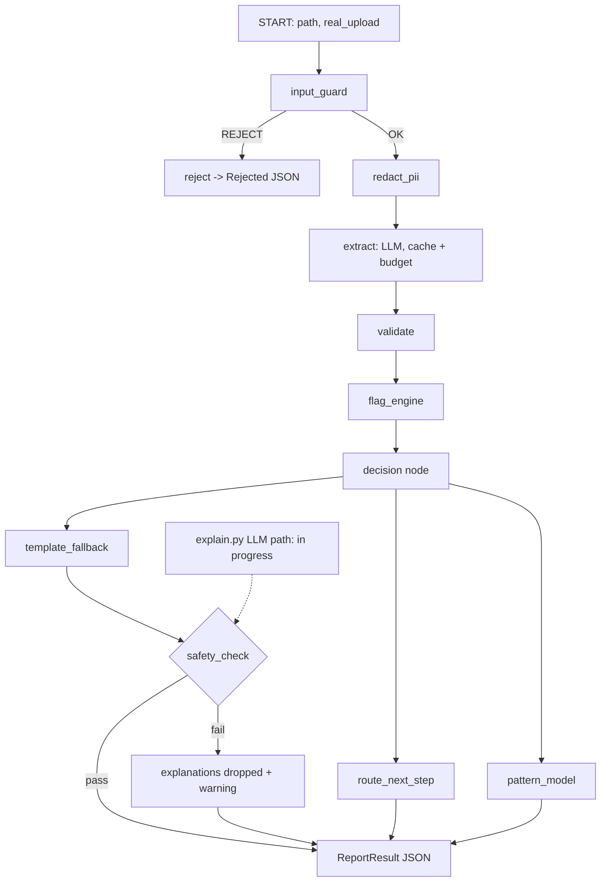

# LabLens codebase map

Last verified: 2026-11-21 against working tree (HEAD c46ba9a plus uncommitted changes).

Items marked **in progress** are being edited by other agents. For those, only symbols and what exists today are cited, not line numbers.

## 1. Overview and how to run

LabLens explains Indian-style lab reports in plain English and Hindi. Code decides flags, severity, criticals and the next step; an LLM only reads the report (extract) and, later, phrases the explanation ([PLAN.md](../PLAN.md) section 3 and 4). Today the repo has the deterministic core, small ML helpers, a synthetic data generator, evals and an ADK 2.0 workflow. The FastAPI service and the frontend are not built. Spec: [PLAN.md](../PLAN.md); API contract: [openapi.yaml](../openapi.yaml).

Test count: 277 collected (`.venv/bin/python -m pytest -q --collect-only`). Pytest config: [pyproject.toml:6-8](../pyproject.toml#L6-L8) (`pythonpath = ["src", "."]`, `testpaths = ["tests"]`).

| Task | Command | Notes |
|---|---|---|
| All tests (offline) | `.venv/bin/python -m pytest -q` | No key needed |
| Synthetic reports | `python scripts/generate_reports.py [--out DIR] [--only IDS...]` | [generate_reports.py:1510-1516](../scripts/generate_reports.py#L1510-L1516); writes `data/reports`, `data/ground_truth`; deterministic; needs `requirements-data.txt` ([data/README.md](../data/README.md)) |
| Generator tests | `python -m pytest tests/test_generator.py` | 32 tests, includes byte-for-byte determinism |
| Critical set (in progress) | `python scripts/generate_critical_set.py [--out DIR]` | `--out` default `data/critical_set` |
| Reference stats | `python scripts/derive_reference_stats.py [--min-count N] [--top N] [--out PATH]` | [derive_reference_stats.py:68-75](../scripts/derive_reference_stats.py#L68-L75); default out `reference/nidaankosha_stats.json` (file not present in the tree) |
| Train ML nodes | `.venv/bin/python scripts/train_ml.py [--out DIR]` | [train_ml.py:97-104](../scripts/train_ml.py#L97-L104); writes `models/*.joblib` and `*.card.json` |
| ML eval (no LLM) | `.venv/bin/python evals/ml_eval.py` | Writes `evals/results_ml.json`; run after training ([ml_eval.py:1-5](../evals/ml_eval.py#L1-L5)) |
| Extraction eval (live Gemini, spends money) | `python evals/extract_eval.py [--no-cache] [--max-inr 20]` | [extract_eval.py:117-122](../evals/extract_eval.py#L117-L122); 15 sources only; writes `evals/results_extract_dev.json` |
| Critical eval (in progress) | `python evals/critical_eval.py [--live] [--max-inr 5]` | Offline by default; `--live` spends money. Writes `evals/results_critical.json` |
| ADK spike | `cd spikes/adk && python run_spike.py` (`--llm` needs a key, not yet run) | [spikes/adk/README.md](../spikes/adk/README.md) |

## 2. Directory map

| Path | Responsibility | PLAN.md |
|---|---|---|
| [src/lablens/](../src/lablens) | Application package | 4, 5 |
| [tests/](../tests) | Pytest suite, one file per module | 7 |
| [data/](../data) | Synthetic reports, ground truth, case specs | 7 (Synthetic data) |
| [reference/](../reference) | YAML reference data used at runtime | 4, 5 |
| [models/](../models) | Trained joblib models and cards | 4 |
| [evals/](../evals) | Eval scripts and their JSON outputs | 7 |
| [scripts/](../scripts) | Generators, training, stats | 7 |
| [spikes/adk/](../spikes/adk) | ADK 2.0 API spike (milestone 2) | 4.1 |
| [docs/plans/](../docs/plans) | Milestone plans m2, m3; [docs/ui/](../docs/ui) is a UI mockup | 13 |
| [cache/](../cache) | SQLite response cache and budget log (runtime, location from `LABLENS_CACHE_DIR`) | 8, 9.1 |
| [openapi.yaml](../openapi.yaml) | API contract; mirrors schemas, enforced by [tests/test_openapi.py](../tests/test_openapi.py) | 6 |

### src/lablens

| Module | Responsibility | PLAN.md | Tests |
|---|---|---|---|
| [schemas.py](../src/lablens/schemas.py) | Pydantic models: `ExtractedTest` :47, `FlaggedTest` :62, `Explanation` :81, `Recommendation` :90, `ReportResult` :110, `Extraction` :154, `ValidatedReport` :161 | 5 | test_openapi |
| [config.py](../src/lablens/config.py) | Env-overridable constants (model, prices, budget, cache paths) | 8, 9 | |
| [reference.py](../src/lablens/reference.py) | YAML loaders: `load_tests` :22, `load_packages` :26, `load_critical_values` :30, `fallback_range` :35, `load_unit_conversions` :50 | 4 | |
| [input_guard.py](../src/lablens/input_guard.py) | `check` :69: sniff type by content, size/page/pixel caps, "looks like a lab report" | 4, 11 | test_input_guard |
| [redact.py](../src/lablens/redact.py) | `redact_pii` :198: regex/label redaction for text PDFs; OCR box masking for images and scans | 4, 10 | test_redact |
| [extract.py](../src/lablens/extract.py) | LLM extraction: `extract_report` :159, `_one_call` :129 (cache, budget), `gemini_call` :96; prompt in [prompts/extract_v1.md](../src/lablens/prompts/extract_v1.md) | 4 | test_pipeline |
| [validate.py](../src/lablens/validate.py) | `validate` :112, `map_test_id` :57, grounding check `_grounded` :85, confidence penalties :14 | 4 | test_validate |
| [flag_engine.py](../src/lablens/flag_engine.py) | `flag_test` :101, `to_canonical` :53, `is_critical` :35, `compute_flag` :12, `compute_severity` :70 | 4 | test_flag_engine |
| [decision.py](../src/lablens/decision.py) | `route_next_step` :34, rules R1 to R6 | 4 | test_decision |
| [glossary.py](../src/lablens/glossary.py) | `glossary_lookup` :11 from [reference/glossary.yaml](../reference/glossary.yaml) | 4 | test_glossary |
| [templates.py](../src/lablens/templates.py) | `urgent_template` :47, `template_fallback` :159; EN and HI, no LLM | 4 | test_templates |
| [safety.py](../src/lablens/safety.py) | `safety_check` :169; rules from [reference/safety_rules.yaml](../reference/safety_rules.yaml); failures tagged "plan" or "render" | 4 (Safety rules) | test_safety |
| [cache.py](../src/lablens/cache.py) | `ResponseCache` :30 (SQLite), `file_sha256` :14, `pipeline_version` :18, `build_prompt` :24 | 9.1, 9.2 | test_cache |
| [budget.py](../src/lablens/budget.py) | `BudgetGuard` :20: `check` :38 reserve, `release` :59, `record` :64; `BudgetExceeded` :9 | 8 | test_budget |
| [pipeline.py](../src/lablens/pipeline.py) | **in progress.** ADK `Workflow` (`workflow`, `run`) wiring the nodes | 4, 4.1 | test_pipeline |
| `explain.py` | **in progress, does not exist yet.** LLM explanation path (`plan_statements`, `render_en`, `render_hi`) | 4 | |
| [ml/__init__.py](../src/lablens/ml/__init__.py) | `load_model` :19 with sha256 check | 4 | test_ml |
| [ml/normalize_names.py](../src/lablens/ml/normalize_names.py) | Name matcher: `normalize_name_with_source` :41, `normalize_names` :53 | 4 | test_ml |
| [ml/pattern_model.py](../src/lablens/ml/pattern_model.py) | `pattern_model` :22: co-occurring abnormal flags, no condition names | 4 | test_ml |
| [ml/data.py](../src/lablens/ml/data.py) | Training and eval data builders, `SEED` :16, train/held-out name rules :20-21 | 7 | test_ml |

`ml/data.py` also builds rows for a flag model. That model is trained and evaluated ([train_ml.py:90](../scripts/train_ml.py#L90), [ml_eval.py:104](../evals/ml_eval.py#L104)) but is not loaded anywhere in `src/` (grep for `load_model(` shows only `normalize_names` and `pattern_model`).

## 3. Request flow

Edges are defined in `pipeline.py` as `workflow = Workflow(name="lablens_extract", edges=[...])` (in progress, so symbols only):

- `("START", input_guard)`
- `(input_guard, {"OK": redact, "REJECT": reject})`
- `(redact, extract, validate, flag_engine, decision)`

There is no `safety_check`, `explain` or parallel render node in the graph yet. `decision` calls `route_next_step`, `template_fallback` and `safety_check` inline, then builds `ReportResult`.

Step by step:

1. **input_guard** ([input_guard.py:69](../src/lablens/input_guard.py#L69)): content sniffing, `MAX_BYTES` :14, `MAX_PAGES` :15, pixel caps :16-17, needs `MIN_TEST_HITS` :20 catalog names. The raw text layer is blanked before it enters session events (comment in `input_guard` node).
2. **redact_pii** ([redact.py:198](../src/lablens/redact.py#L198)): text PDFs go through `redact_text` :124 (header block masked up to the first test row by `_mask_header_block` :63, labelled fields by `_redact_labels` :84); scans and images go through `redact_image` :179 with a `HEADER_BAND` :14 mask plus OCR boxes.
3. **extract** ([extract.py:159](../src/lablens/extract.py#L159)): one call, plus one targeted retry if `missing_expected` finds panel tests absent ([validate.py:102](../src/lablens/validate.py#L102)). Retry rows are merged by mapped test id. Node-level retry is ADK `RetryConfig` on `ServerError` only (comment above the `extract` node in `pipeline.py`).
4. **validate** ([validate.py:112](../src/lablens/validate.py#L112)): drop blank rows; drop values not found in the redacted source text (`_grounded` :85, only when text exists); map names with `map_test_id` ([validate.py:57](../src/lablens/validate.py#L57)). Name order: **alias dictionary** (full name, then variants) -> **ML matcher** (`normalize_name_with_source`, source "model", flagged low confidence and "please verify" warning at validate.py:134-135) -> **LLM `test_id_hint`** (source "hint", confidence penalty `hint_only`). Unmapped rows go to `unrecognised_tests`.
5. **flag_engine** ([flag_engine.py:126](../src/lablens/flag_engine.py#L126)): resolve range (printed, else fallback table), convert units to canonical, compute flag, `is_critical`, severity, printed-flag disagreement.
6. **decision** ([decision.py:34](../src/lablens/decision.py#L34)): R1_critical -> R2_marked -> R3_package -> R4_mild / R4_printed_flag -> R5_verify -> R6_normal, first match wins.
7. **Explanation**: `template_fallback` ([templates.py:159](../src/lablens/templates.py#L159)) then `safety_check` ([safety.py:169](../src/lablens/safety.py#L169)). If any failure, explanations are emptied and a warning added; flags and next step still return. The LLM plan/render path (PLAN.md section 4 nodes `plan_statements`, `render_en`, `render_hi`) is **in progress** in `explain.py`.
8. **ReportResult** ([schemas.py:110](../src/lablens/schemas.py#L110)): status "partial" if rows were dropped, unrecognised, low confidence or expected tests missing; `report_id` is the first 16 hex chars of the file sha256; metrics carry tokens and cost.

## 4. Data

| Location | Contents | Use |
|---|---|---|
| [data/reports/source/](../data/reports/source) | D01-D15 PDFs (15) | **Tuning only** (prompts, thresholds); never scored in headline numbers |
| [data/reports/eval/](../data/reports/eval) | E01-E30 PDFs (30) plus 6 PNG scans | **Frozen** eval set, scored; see [data/README.md](../data/README.md) for the four variation groups |
| [data/ground_truth/](../data/ground_truth) | One JSON per case (45) plus `index.json` | Exact expected rows, flags, next step |
| [data/case_specs.yaml](../data/case_specs.yaml) | Hand-written specs for all 45 cases | Generator input |
| [data/critical_set/](../data/critical_set) | **In progress.** `rows.json`, `reports/`, `ground_truth/Cxx.json` | **Held-out**: verification only, never for tuning ([generate_critical_set.py:1-12](../scripts/generate_critical_set.py#L1-L12)) |

Caveat: ML models were trained on names and flag sets derived from these generators, and the held-out name set was inspected once after the first run ([README.md:10-12](../README.md#L10-L12)), so it is "slightly less blind".

[reference/](../reference) (all demo values, not clinician-reviewed):

| File | Holds |
|---|---|
| [panels.yaml](../reference/panels.yaml) | Tests: aliases, canonical units, fallback ranges, criticals, plausible limits, alt units |
| [unit_conversions.yaml](../reference/unit_conversions.yaml) | Extra printed-unit conversions (printed = canonical x factor) |
| [packages.yaml](../reference/packages.yaml) | Follow-up test packages for rule R3 |
| [glossary.yaml](../reference/glossary.yaml) | Per-test plain-language EN/HI text (model-written; Hindi needs review) |
| [safety_rules.yaml](../reference/safety_rules.yaml) | Banned phrases and direction words for `safety_check` |

[models/](../models): `normalize_names`, `pattern_model`, `flag_model`, each `.joblib` with a `.card.json`. `load_model` ([ml/__init__.py:19-30](../src/lablens/ml/__init__.py#L19-L30)) refuses to load if the card is missing or its `sha256` differs (joblib is pickle).

[evals/](../evals) outputs:

| File | Written by | Set |
|---|---|---|
| `results_ml.json` | `ml_eval.py` | Eval cases plus held-out names and flag sets; keys `normalize_names`, `pattern_model`, `flag_model` |
| `results_extract_dev.json` | `extract_eval.py` ([:26](../evals/extract_eval.py#L26)) | Source D01-D15 only (dev/tuning, not the frozen set) |
| `results_critical.json` | `critical_eval.py` (in progress) | Held-out critical set |

Note: no script scores the frozen E01-E30 set end to end yet. `extract_eval.py` is documented to use sources only ([:1-5](../evals/extract_eval.py#L1-L5)).

## 5. Configuration and environment variables (names only)

| Name | Read at | Default / role |
|---|---|---|
| `GOOGLE_API_KEY` | [extract.py:102](../src/lablens/extract.py#L102) via `load_dotenv()`; also [.env.example](../.env.example) | Gemini key; never logged |
| `GOOGLE_GENAI_USE_VERTEXAI` | Only listed in [.env.example](../.env.example); read by the Google SDK, not by repo code | Vertex toggle |
| `LABLENS_MODEL` | [config.py:11](../src/lablens/config.py#L11) | `gemini-3.1-flash-lite` |
| `LABLENS_USD_PER_M_INPUT` | [config.py:14](../src/lablens/config.py#L14) | 0.25 |
| `LABLENS_USD_PER_M_OUTPUT` | [config.py:15](../src/lablens/config.py#L15) | 1.50 (thinking billed as output) |
| `LABLENS_INR_PER_USD` | [config.py:16](../src/lablens/config.py#L16) | 90.0 |
| `LABLENS_BUDGET_CAP_INR` | [config.py:19](../src/lablens/config.py#L19) | 500.0 |
| `LABLENS_BUDGET_GUARD_INR` | [config.py:21](../src/lablens/config.py#L21) | 450.0; calls refused past this |
| `LABLENS_CACHE_DIR` | [config.py:23](../src/lablens/config.py#L23) | `cache`; holds `responses.sqlite` and `budget.sqlite` (:24-25) |
| `SPIKE_MODEL` | [spikes/adk/lab_spike/agent.py:74](../spikes/adk/lab_spike/agent.py#L74) | Spike only |

Config is read at import time, so changing an env var needs a new process. `.env` is git-ignored and was not opened.

## 6. Safety invariants and where they are enforced

| Invariant | Enforcement |
|---|---|
| Critical is decided by rules only, never a model | `is_critical` ([flag_engine.py:35](../src/lablens/flag_engine.py#L35)) with thresholds from `load_critical_values`; routing R1 in [decision.py:49-51](../src/lablens/decision.py#L49-L51). The flag model is not loaded in `src/` (measured 44/62 criticals, see [README.md](../README.md)) |
| Unit conversion happens before the critical check | `to_canonical` ([flag_engine.py:53](../src/lablens/flag_engine.py#L53)) is called in `flag_test`, and `is_critical(canon, ...)` uses the canonical value ([:101-114](../src/lablens/flag_engine.py#L101-L114)). Unknown unit -> `Flag.UNKNOWN`, never silently normal, routes to R5 |
| Real uploads are never cached | `ResponseCache.get` and `put` return early on `real_upload` ([cache.py:44-46](../src/lablens/cache.py#L44-L46), [:56-58](../src/lablens/cache.py#L56-L58)); flag flows from `input_guard` node into `extract_report` |
| Budget reserved before each LLM call | `guard.check` raises `BudgetExceeded` ([extract.py:137](../src/lablens/extract.py#L137), [budget.py:38-57](../src/lablens/budget.py#L38-L57)); atomic `BEGIN IMMEDIATE`; released on failure ([extract.py:149-150](../src/lablens/extract.py#L149-L150)) |
| Redaction precedes any LLM call | Graph order `redact -> extract`; `extract` takes `RedactedDoc` ([extract.py:96](../src/lablens/extract.py#L96)) |
| Model files verified before load | sha256 vs card ([ml/__init__.py:25-29](../src/lablens/ml/__init__.py#L25-L29)) |
| No explanation shown without `safety_check` | `decision` node empties explanations on any failure ([pipeline.py](../src/lablens/pipeline.py), in progress); checks in [safety.py:169](../src/lablens/safety.py#L169) incl. fixed urgent text for criticals |
| Model- or hint-mapped names are never trusted silently | Low-confidence + "please verify" in `validate` ([validate.py:57-74](../src/lablens/validate.py#L57-L74), :132-135) |
| Values not in the source text are dropped | `_grounded` ([validate.py:85](../src/lablens/validate.py#L85)) |

## 7. Known gaps and TODO

From PLAN.md and the code:

- FastAPI service, rate limits, consent flow, saved history and the frontend are not built (PLAN.md sections 4.2, 4.3, 6, 10). No `fastapi` code exists under `src/`; [openapi.yaml](../openapi.yaml) is the only artefact.
- LLM explanation path (`plan_statements`, `render_en`, `render_hi`, parallel fan-out and retries) is in progress; only templates run today.
- Redaction only masks names before the first recognised test row per page ([redact.py:63-82](../src/lablens/redact.py#L63-L82)); bare names after the first test row are not redacted unless caught by label, honorific or other patterns.
- `BudgetExceeded` from `extract` is not caught in the workflow, so there is no template fallback at extraction time (the message text mentions one, [budget.py:48-50](../src/lablens/budget.py#L48-L50)). Not verified end to end.
- Upload limits disagree: `MAX_BYTES` is 10 MB ([input_guard.py:14](../src/lablens/input_guard.py#L14)); [openapi.yaml](../openapi.yaml) states 5 MB.
- Hindi text (glossary, templates, safety rules) is model-written and unreviewed; glossary and reference data are not clinician-reviewed.
- Frozen E01-E30 has no end-to-end scoring script yet; `evals/results_extract_dev.json` covers the sources.
- ADK `Runner` inside FastAPI and a live Gemini `output_schema` run are unconfirmed ([spikes/adk/README.md](../spikes/adk/README.md)); the spike's `--llm` path has not been run.
- Name matcher gives a small gain over the dictionary and a 1.8% wrong-mapping rate on held-out names ([README.md](../README.md)); flag model is trained but unused.
- `reference/nidaankosha_stats.json` (output of `derive_reference_stats.py`) and `docs/architecture` docs do not exist.
- Everything under `src/lablens/{extract,validate,pipeline,...}.py`, `evals/`, `data/critical_set/` is untracked in git at this snapshot.
